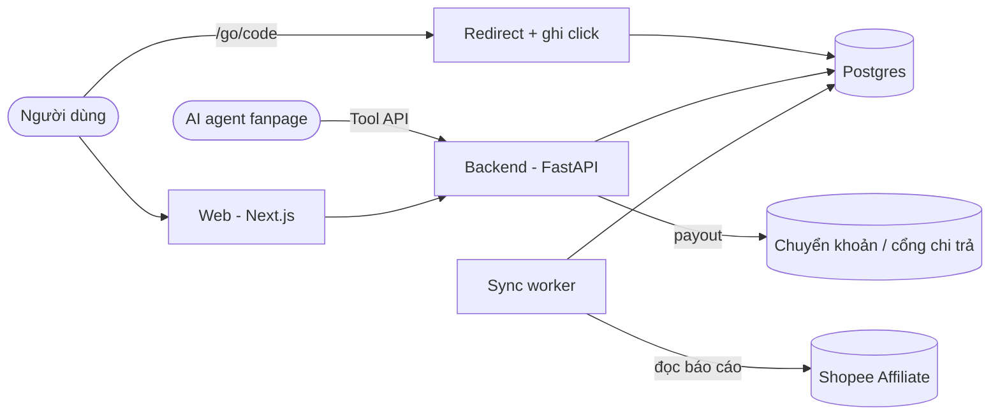

# CashBack — nền tảng hoàn tiền Shopee Affiliate

> Web hoàn tiền (cashback) cho người mua trên Shopee Việt Nam: dán link sản phẩm → nhận link affiliate → mua hàng → nhận lại một phần hoa hồng vào ví và rút về. Kèm một Tool API để một AI agent tự tìm sản phẩm và tạo link theo từng bài đăng fanpage, rồi học xem ngành nào ra tiền.

**Trạng thái:** đang phát triển (Sprint 0). Đã có service tạo link, codec `sub_id` có chữ ký và bộ tài liệu thiết kế; web, ví và đồng bộ đơn đang được xây.

## Bài toán

Shopee Affiliate không có API chính thức hay webhook để biết đơn nào đến từ ai. Muốn hoàn tiền đúng người, hệ thống phải:

1. Gắn **danh tính nguồn** vào từng link ngay trong tham số `utm_content` (chỉ có 5 ô, cách nhau bằng `-`).
2. Đọc báo cáo của Shopee, **khớp ngược** từng đơn về đúng người dùng hoặc đúng bài đăng.
3. Quản lý tiền như một hệ thống tài chính thật: trạng thái chờ → rút được → đã hủy, không bao giờ âm, không bao giờ ghi trùng.

## Kiến trúc



- **Chi phí hạ tầng 0đ:** web và redirect trên edge miễn phí, Postgres free tier, riêng worker đồng bộ chạy ở máy cá nhân vì Shopee chặn IP datacenter.
- Thiết kế chịu lỗi: nếu phiên đăng nhập Shopee hết hạn, hệ thống **ngừng cộng tiền**, cảnh báo, và có đường nhập báo cáo thủ công thay thế.

## Điểm kỹ thuật đáng chú ý

| Chủ đề | Cách làm |
|---|---|
| **Truy vết đơn hàng** | Codec `sub_id` phiên bản hóa: `1u-<user>-<click>-<chữ ký>-`. Mỗi ô chỉ `[0-9a-z]`, ngắn (base36), không chứa dữ liệu cá nhân. Chữ ký HMAC chống giả mạo; đơn không khớp được đưa vào hàng "đơn mồ côi" |
| **Tiền** | Số nguyên (không float), làm tròn xuống, sổ cái chỉ thêm với khóa idempotent, ví có ràng buộc không âm ở tầng DB |
| **Đồng bộ** | Quét lại cửa sổ 60 ngày để bắt đơn đổi trạng thái; chạy bù khi bật lại; đánh dấu lần sync dở dang thay vì cắt dữ liệu im lặng |
| **Bảo mật** | Cookie Shopee mã hóa at-rest, rate limit, RBAC, audit log, validate host đầu vào chống SSRF/open redirect |
| **Chống gian lận** | Cờ theo IP/thiết bị băm, tỷ lệ hủy bất thường, thời gian giữ tiền trước khi cho rút |
| **AI agent** | API riêng có key: tìm sản phẩm theo % hoa hồng, tạo link theo bài, đọc thống kê theo ngành/giờ để agent tự điều chỉnh |

## Công nghệ

Python (FastAPI, SQLAlchemy/Alembic), PostgreSQL, Next.js, Docker Compose, Cloudflare (Pages/Workers/Tunnel), GitHub Actions.
Phần hiện có dùng Python chuẩn và SQLite; phần còn lại là kế hoạch trong [`docs/`](docs/).

## Cấu trúc thư mục

```
packages/core/       # codec sub_id v1 (đã có, có test)
docs/                # phân tích, kiến trúc, ERD, API, rủi ro, backlog, kế hoạch sprint
docs/legacy/         # tài liệu của service tạo link ban đầu
backlog/issues.csv   # backlog Scrum (41 story, import được vào GitHub Projects)
*.py                 # service tạo link + đọc doanh thu ban đầu (sẽ chuyển vào services/link-api)
```

## Chạy test

```bash
python3 test_offline.py                      # service tạo link (mock, không gọi mạng)
python3 test_make_link_regression.py         # khóa hành vi sinh link affiliate
PYTHONPATH=packages/core python3 -m unittest discover -s packages/core/tests   # codec sub_id
```

## Tài liệu thiết kế

| | |
|---|---|
| [Tổng quan](docs/01-tong-quan.md) · [Tác nhân](docs/02-tac-nhan.md) · [Chức năng](docs/03-chuc-nang.md) | Phạm vi và người dùng |
| [Luồng nghiệp vụ](docs/04-luong-nghiep-vu.md) · [Trạng thái](docs/05-trang-thai.md) | Sequence và state diagram |
| [Kiến trúc](docs/06-kien-truc.md) · [Dữ liệu và sub_id](docs/07-du-lieu.md) · [API](docs/08-api.md) | Thiết kế kỹ thuật |
| [Phi chức năng](docs/09-phi-chuc-nang.md) · [Rủi ro](docs/10-rui-ro.md) | Bảo mật, chịu lỗi, rủi ro |
| [Quy trình Scrum](docs/11-scrum.md) · [Backlog](docs/12-backlog.md) · [Kế hoạch sprint](docs/13-ke-hoach-sprint.md) | Cách làm việc |

## Cách làm việc

Dự án do một người thực hiện, có sự hỗ trợ của các công cụ AI (Claude Code, Codex, Antigravity) theo quy trình Scrum: backlog có acceptance criteria dạng Given/When/Then, mỗi task một nhánh, luật chung ở [`AGENTS.md`](AGENTS.md).

## Lưu ý

Dự án học tập và portfolio. Không chứa khóa, cookie hay dữ liệu người dùng thật. Mô hình hoàn tiền phụ thuộc điều khoản của Shopee Affiliate; chỉ vận hành thật khi đã được chấp thuận.
