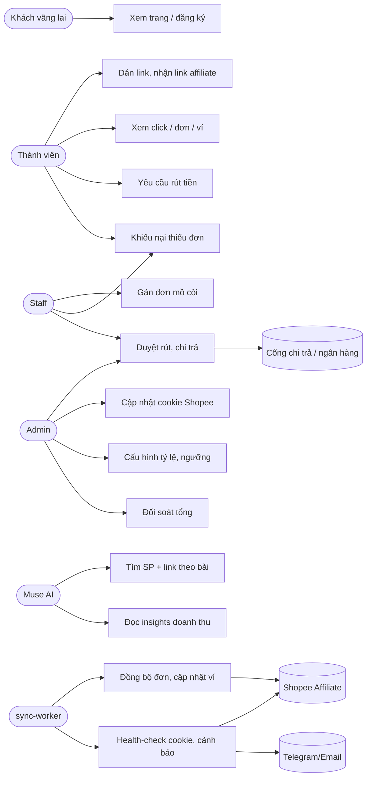

# 02 — Tác nhân

| Tác nhân | Loại | Mục tiêu | Quyền | Tần suất | Thiết bị |
|---|---|---|---|---|---|
| Khách vãng lai | Người | Xem trang, hiểu cách hoạt động, đăng ký | Xem trang công khai; **không** tạo link | Lần đầu | Mobile chủ yếu |
| Thành viên (`member`) | Người | Tạo link, mua hàng, nhận hoàn tiền, rút | Dữ liệu của chính mình | Vài lần/tuần | Mobile web, desktop |
| Admin (`admin`) | Người (PO) | Quản lý toàn hệ thống, duyệt rút, đối soát, cookie, cấu hình tỷ lệ | Toàn quyền | Hằng ngày | Desktop |
| Nhân viên CSKH/đối soát (`staff`) | Người | Gán đơn mồ côi, xử lý khiếu nại, duyệt rút (nếu admin giao) | Không đổi cookie, không đổi cấu hình tỷ lệ | Hằng ngày | Desktop |
| Muse AI (fanpage agent) | Hệ thống ngoài do PO kiểm soát | Tìm SP, lấy link affiliate theo từng bài, đọc doanh thu để học | Chỉ gọi **Tool API** bằng API key riêng, không chạm user/ví | Nhiều lần/ngày | Máy chạy agent |
| Job đồng bộ (`sync-worker`) | Hệ thống | Kéo click/đơn từ Shopee, cập nhật ví, health-check cookie | Ghi DB; đọc cookie đã mã hóa | Mỗi 30–60 phút | Máy nhà |
| Job nội bộ khác | Hệ thống | Chuyển `pending`→`available`, backup, dọn dữ liệu | Ghi DB | Hằng ngày | Máy nhà |
| Shopee Affiliate | Hệ thống ngoài | Nguồn sự thật về click/đơn/hoa hồng | Dashboard nội bộ qua cookie (không chính thức) | — | — |
| Facebook | Hệ thống ngoài | Nơi Muse AI đăng bài | Ta **không** gọi Facebook | — | — |
| Kênh chi trả (ngân hàng/cổng) | Hệ thống ngoài | Chuyển tiền cho user | Qua `PayoutProvider` | Khi có yêu cầu rút | — |
| Telegram/Email | Hệ thống ngoài | Nhận cảnh báo (admin) và email giao dịch (user) | Chỉ gửi đi | — | — |

