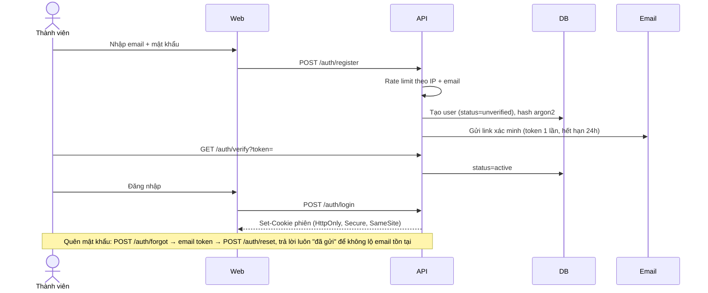
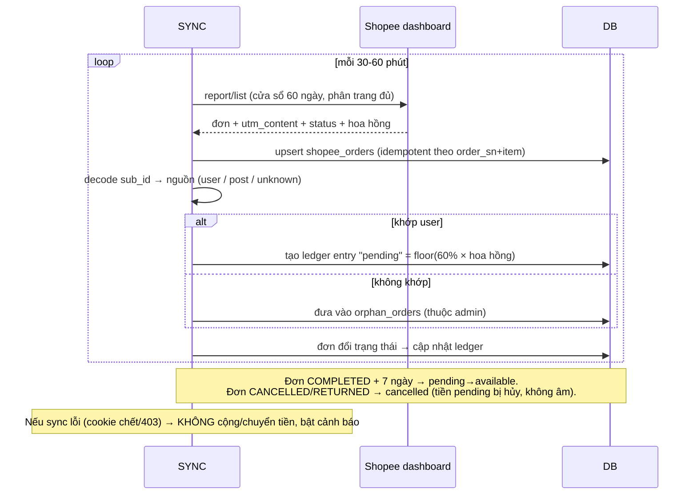
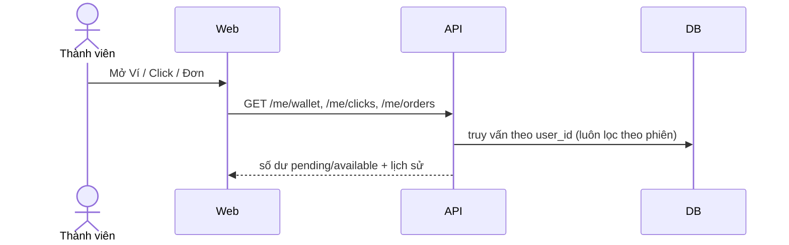
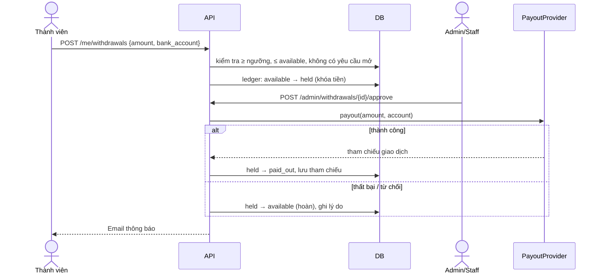
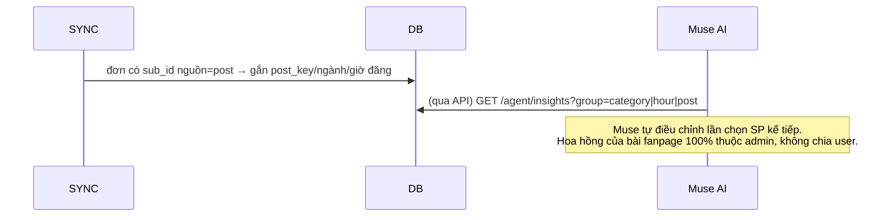
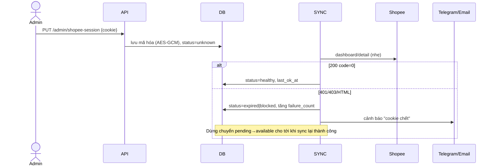
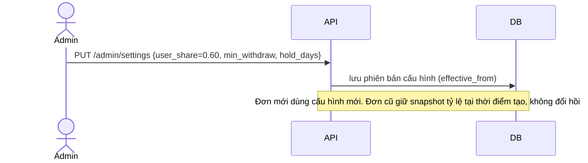

# 04 — Luồng nghiệp vụ

Quy ước: `API` = backend chính (FastAPI), `LINK` = link-api (`/go/` + tool API), `SYNC` = sync-worker, `DB` = Postgres.
Do Muse AI tự đăng bài ngoài hệ thống, các luồng 8–10 được viết lại theo mô hình "agent gọi Tool API". Luồng 10 ("tự đăng không cần duyệt") không còn là chức năng của ta.

## 1. Đăng ký / đăng nhập / quên mật khẩu


## 2. Dán link → link affiliate
```mermaid
sequenceDiagram
  actor U as Thành viên
  participant W as Web
  participant API
  participant DB
  U->>W: Dán link Shopee
  W->>API: POST /links {url}
  API->>API: Kiểm tra host thuộc shopee.vn/s.shopee.vn/shope.ee
  API->>API: parse shop_id,item_id (affiliate.parse_product_url)
  API->>DB: upsert product; insert link (user_id, product_id) → link_code
  API-->>W: go_url = https://<host>/go/<link_code>, direct_url = link affiliate dự phòng (sub_id mức link)
  Note over API: Link ngắn s.shopee.vn: theo redirect tối đa 3 lần, chỉ tới host Shopee
```

## 3. Bấm link → redirect → mua
```mermaid
sequenceDiagram
  actor U as Thành viên
  participant LINK as link-api /go
  participant DB
  participant SP as Shopee
  U->>LINK: GET /go/<link_code>
  LINK->>DB: lookup link; insert click (click_id, ip_hash, ua)
  LINK->>LINK: sub_id = encode(v1, source=u, user, click_id)
  LINK-->>U: 302 → universal-link ... utm_content=<sub_id>
  U->>SP: Mở app/web Shopee, mua hàng
  Note over LINK,DB: Nếu DB lỗi: vẫn 302 bằng sub_id mức link (không có click_id) để không mất đơn
```

## 4. Đồng bộ đơn → ví (chờ → khả dụng → hủy)


## 5. Xem lịch sử


## 6. Rút tiền


## 7. Khiếu nại "mua rồi chưa thấy đơn"
```mermaid
sequenceDiagram
  actor U as Thành viên
  participant API
  participant DB
  actor S as Staff
  U->>API: POST /me/claims {order_sn hoặc ngày + sản phẩm}
  API->>DB: tra click của user trong khoảng thời gian; kiểm tra đơn Shopee đã về chưa
  alt đơn đã có và khớp
    API-->>U: "Đơn đang ở trạng thái X, dự kiến vào ví lúc Y"
  else đơn mồ côi cùng sản phẩm/giờ
    API->>S: đưa vào hàng chờ
    S->>DB: gán đơn mồ côi → user (có lý do, audit log)
  else chưa có đơn
    API-->>U: "Shopee thường mất 24–48h để hiển thị đơn"
  end
```

## 8. Muse AI lấy sản phẩm + link cho một bài (thay cho luồng "AI fanpage" cũ)
```mermaid
sequenceDiagram
  participant M as Muse AI
  participant LINK as link-api (Tool API)
  participant FEED as feed.csv
  participant DB
  M->>LINK: GET /agent/insights?days=30 (ngành nào ra tiền)
  LINK-->>M: top ngành, giờ, kiểu bài theo hoa hồng thật
  M->>LINK: GET /agent/search?keyword=&min_rate=
  LINK->>FEED: tìm + lọc giá/đã bán
  LINK-->>M: danh sách SP + % hoa hồng
  M->>LINK: POST /agent/links {item, post_key, page_code}
  LINK->>DB: lưu post (post_key↔sub_id, page, category)
  LINK-->>M: aff_link (utm_content=<v1,p,post,...>)
  M->>M: Viết bài/video, đăng lên fanpage (ngoài hệ thống ta)
```

## 9. Vòng học


## 10. (Bỏ) Tự đăng không duyệt
Do Muse AI đăng ngoài hệ thống, ta không cần cơ chế này. Giới hạn số bài/ngày (nếu muốn) cấu hình ở Muse.

## 11. Cập nhật cookie → health-check → cảnh báo


## 12. Đối soát
```mermaid
sequenceDiagram
  actor A as Admin
  participant API
  participant DB
  A->>API: GET /admin/reconciliation?month=
  API->>DB: Σ hoa hồng Shopee (đơn COMPLETED) = X
  API->>DB: Σ chia user (pending+available+paid) = Y; Σ đơn hủy; Σ mồ côi = Z
  API-->>A: X − Y − Z = lợi nhuận giữ lại; cờ nếu lệch ≠ 0
```

## 13. Cấu hình tỷ lệ, ngưỡng


## 14. Xử lý gian lận
```mermaid
sequenceDiagram
  participant SYNC
  participant DB
  actor S as Staff
  SYNC->>DB: quy tắc: user mua qua link của chính mình? (khớp device/IP của click với tài khoản)
  SYNC->>DB: nhiều tài khoản cùng ip_hash/device trong 24h; tỷ lệ hủy > ngưỡng
  SYNC->>DB: tạo fraud_flag (rule, điểm)
  S->>DB: xem cờ → giữ pending / khóa tài khoản / bỏ qua (có audit)
```
