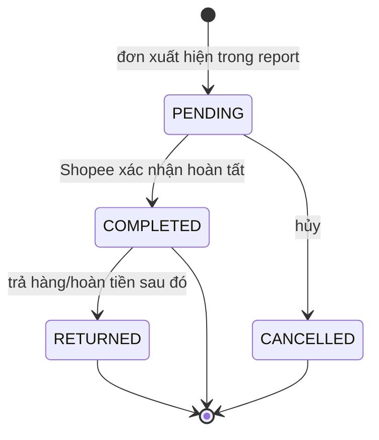
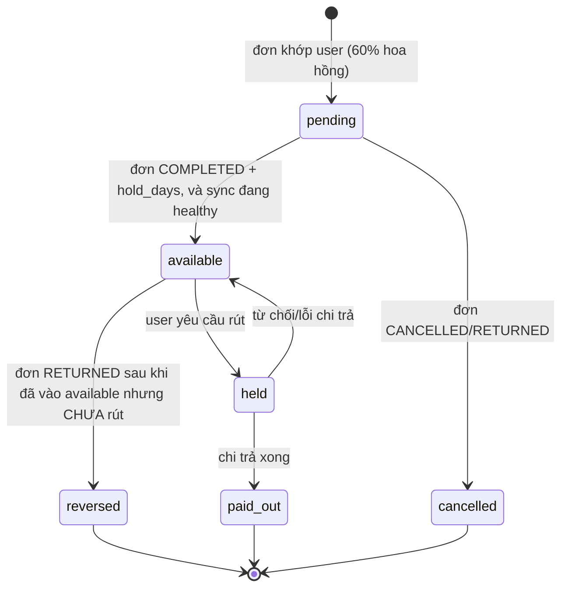
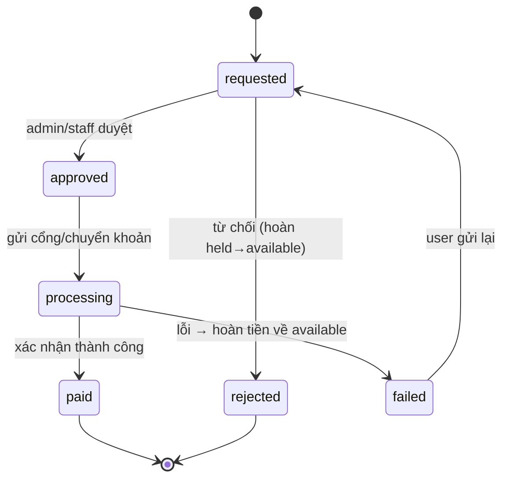
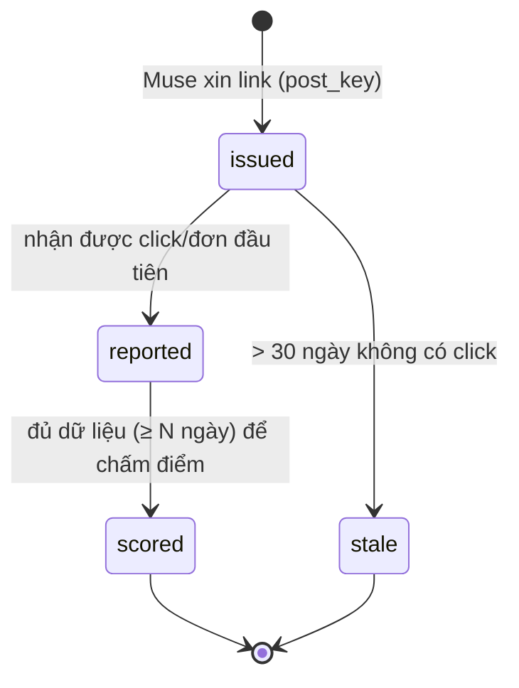
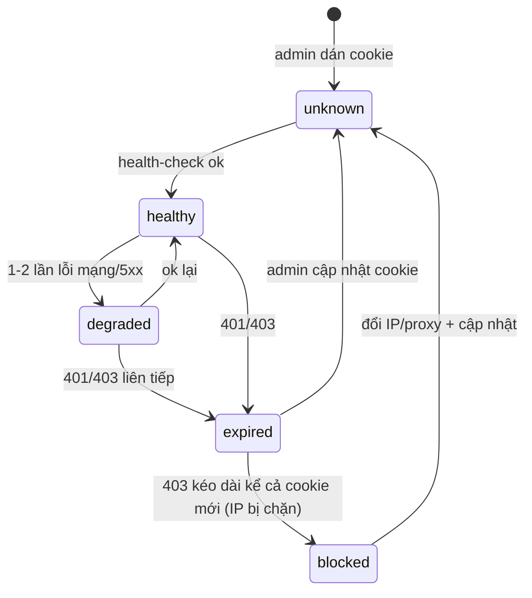

# 05 — Máy trạng thái

## 1. Đơn hàng Shopee (`shopee_orders.status`)
Trạng thái do Shopee quyết định; ta chỉ phản ánh. Tên cụ thể cần đối chiếu với dữ liệu thật (hiện đã thấy `COMPLETED`).

`status` lạ chưa biết → lưu nguyên văn vào `raw_status`, coi là `PENDING` và gắn cờ cho admin.

## 2. Giao dịch hoàn tiền trong ví (`wallet_entries`)

Ràng buộc: tổng `available` không bao giờ < 0. Chỉ `available` mới rút được, nên trường hợp trả hàng sau khi rút được giảm thiểu bằng `hold_days`. Nếu vẫn xảy ra, ghi nhận là **lỗ của admin** (`loss_entries`), không trừ âm ví user.

## 3. Yêu cầu rút tiền

## 4. Bài đăng của Muse AI (`posts`, chỉ để thống kê)

Không có `draft/approved/published`: việc đăng là của Muse.

## 5. Phiên cookie Shopee (`shopee_sessions`)

Khi `expired/blocked`: cảnh báo, dừng chuyển `pending→available`, vẫn cho nhận click; staff có thể dùng import CSV.
