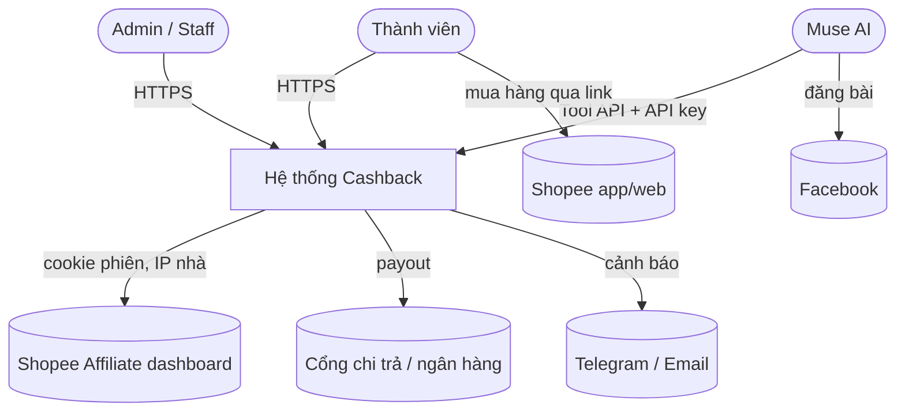
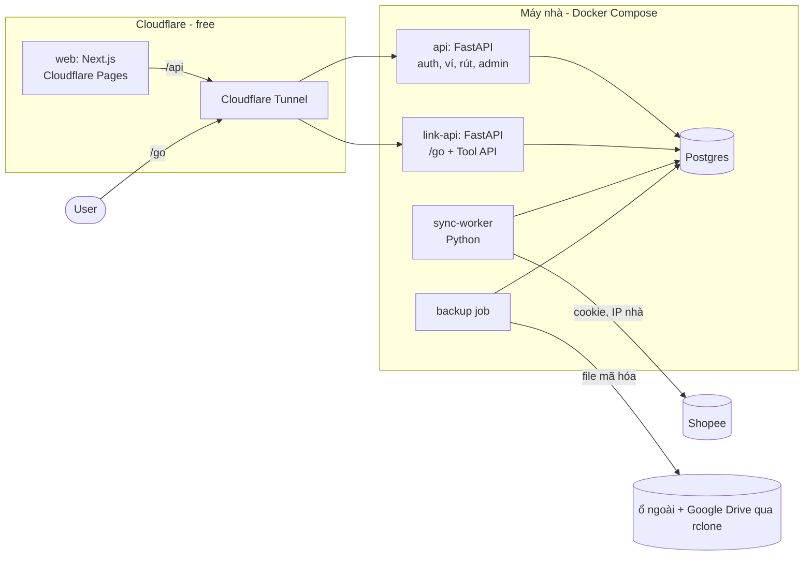

# 06 — Kiến trúc

## 0. Cập nhật hạ tầng (2026-11-27, theo PO: dùng free tier Vercel / Cloudflare / AWS)

Phần này **thay thế** các mục 2, 4, 5, 6 bên dưới ở chỗ mâu thuẫn. Ràng buộc cứng không đổi: Shopee chặn IP datacenter (Vercel, Cloudflare, AWS đều là datacenter), nên **chỉ `sync-worker` bắt buộc chạy ở máy nhà**. Mọi thứ còn lại có thể lên cloud free.

| Thành phần | Chỗ chạy | Ghi chú |
|---|---|---|
| Web (Next.js) | **Cloudflare Pages** (ưu tiên) hoặc Vercel | Vercel Hobby ghi là dành cho dùng phi thương mại; site có thu hoa hồng nên PO cần đọc điều khoản trước. Cloudflare không có hạn chế đó theo hiểu biết của tôi, cần PO kiểm tra lại |
| `/go/{code}` (redirect + ghi click) | **Cloudflare Worker** | Luôn bật, không phụ thuộc máy nhà → **giải quyết rủi ro R-11** (máy tắt vẫn ghi click). Ghi DB qua Neon HTTP driver |
| `api` (auth, ví, rút, admin, Tool API) | Vercel (Python serverless) **hoặc** Cloudflare Workers; nếu FastAPI không hợp serverless thì để ở máy nhà sau Tunnel | Chốt ở Sprint 0 bằng spike nhỏ; tránh hàm chạy lâu vì giới hạn thời gian của gói free |
| Postgres | **Neon free** (hoặc Supabase free) | Dùng chung cho cloud và máy nhà qua `DATABASE_URL`; kiểm tra giới hạn dung lượng/ngủ đông khi đăng ký |
| `sync-worker` + job `pending→available` | **Máy nhà** (IP nhà) | Kết nối Neon qua Internet. Máy tắt thì sync dừng, nhưng cũng đúng ý: không sync thì không chuyển tiền |
| Backup | `pg_dump` từ máy nhà lên Google Drive/ổ ngoài; thêm bản của chính Neon nếu gói có | |

Điểm cần PO lưu ý về **AWS**: gói free thường yêu cầu thẻ và có thể phát sinh phí ngoài ý muốn, trái với ràng buộc "không thẻ/không phát sinh phí" lúc đầu. Khuyến nghị **không dùng AWS ở MVP**; nếu vẫn muốn dùng, phải đặt cảnh báo ngân sách (AWS Budgets) trước. IP của AWS cũng sẽ bị Shopee chặn như các datacenter khác, nên không giúp được phần sync.

Hệ quả cho code: `DATABASE_URL` và các kết nối ngoài đều qua biến môi trường; `/go` viết gọn, không phụ thuộc thư viện nặng để chạy được trên Worker; bí mật (khóa mã hóa, cookie) chỉ ở biến môi trường của nơi cần dùng (`sync-worker` giữ khóa giải mã cookie, Worker/`api` không cần cookie).

---

## 1. Context (C4 mức 1)

## 2. Container (C4 mức 2)

- Mã dùng chung (`packages/core`): codec `sub_id`, tiền (số nguyên), client Shopee, cấu hình.
- `ai-agent` **không còn là service của ta**: Muse AI là agent ngoài, gọi `link-api`. Thư mục `services/ai-agent` được thay bằng `link-api/agent` (Tool API).
- **Không dùng Redis ở MVP.** Rate limit, hàng đợi job, khóa phân tán dùng Postgres (`SELECT … FOR UPDATE SKIP LOCKED`, bảng `rate_limits`). Thêm Redis khi có tải thật.

## 3. Lựa chọn công nghệ (chi phí 0đ)

| Hạng mục | Chọn | Lý do | Phương án thay thế |
|---|---|---|---|
| Backend | **FastAPI** (Python) | Cùng ngôn ngữ với code hiện có (`affiliate.py`, `revenue.py`), tái sử dụng được | Node/NestJS: phải viết lại logic |
| DB | **Postgres 16** | Transaction, ràng buộc cho ví | SQLite: không đủ cho ví đa tiến trình |
| Migration | Alembic | Chuẩn với SQLAlchemy | |
| Web | **Next.js** → Cloudflare Pages (hoặc Vercel) | Free, không cần thẻ (cần xác nhận lúc đăng ký) | Vite SPA: đơn giản hơn, ít SEO |
| Đưa ra Internet | **Cloudflare Tunnel** | Free, không mở cổng router | ngrok free (URL đổi), Tailscale Funnel |
| Email giao dịch | SMTP từ nhà cung cấp có gói free (chọn khi vào Sprint 1, kiểm tra không cần thẻ) | Chỉ cần xác minh/quên mật khẩu | |
| Cảnh báo | Telegram Bot | Free | Email |
| Backup | `pg_dump` hằng ngày → ổ ngoài + Google Drive (rclone) | Không cần thẻ | R2/S3: thường cần thẻ → bị loại |
| CI | GitHub Actions (free cho repo) | | |

Loại bỏ dịch vụ cần thẻ tín dụng hoặc có thể phát sinh phí (AWS, GCP, Azure, Oracle Always Free, Fly.io, v.v.). **Câu trả lời "thuê cloud miễn phí" của PO được hiểu là: cloud free tier không cần thẻ; nếu chỉ còn lựa chọn cần thẻ thì giữ máy nhà.**

## 4. Vì sao chạy ở máy nhà
- Shopee chặn IP datacenter (403) với endpoint dashboard. `sync-worker` phải ra từ IP nhà.
- `api` và `link-api` dùng chung Postgres với `sync-worker`; để đơn giản và nhất quán, chạy cùng máy.
- `DATABASE_URL` là điểm đổi duy nhất: có thể trỏ sang **Neon free** (không cần thẻ, cần xác nhận lại lúc đăng ký) để web/api sống kể cả khi máy nhà tắt. Mã không phụ thuộc vị trí DB. Lưu ý độ trễ và giới hạn dung lượng của gói free.

## 5. Chịu lỗi khi máy nhà tắt / mất mạng
| Tình huống | Hành vi |
|---|---|
| Máy tắt | `/go/` không phản hồi. Web (Pages) vẫn hiện, báo "bảo trì". **Link `direct_url`** (affiliate trực tiếp, `sub_id` mức link) vẫn dùng được và vẫn ra hoa hồng. |
| Bật lại | `sync-worker` quét 60 ngày nên bù đủ; đơn không bị mất vì Shopee giữ dữ liệu |
| Mất mạng nhưng máy chạy | Giống trên; `sync-worker` retry với backoff |
| Cookie chết | Cảnh báo; dừng cộng/chuyển tiền; staff dùng import CSV |
| Mất điện giữa chừng giao dịch ví | Mọi thay đổi số dư nằm trong 1 transaction Postgres, job idempotent |

**Quyết định mặc định cho câu 17:** chấp nhận mất log click khi máy tắt (A4). Đổi nếu PO cần.

## 6. Triển khai
- **Dev:** `docker compose up` (Postgres, api, web, link-api, sync-worker rỗng), `MOCK=1`.
- **Prod (MVP):** cùng compose trên máy nhà + `cloudflared`; web lên Cloudflare Pages. Máy nên bật `restart: unless-stopped` và tự chạy lại khi khởi động.
- Secret chỉ ở `.env` trên máy (không commit); cookie Shopee lưu trong DB dạng mã hóa bằng khóa `APP_ENC_KEY`.

## 7. Đường nâng cấp khi có tiền
1. VPS nhỏ ở Việt Nam cho `api/link-api/Postgres`, giữ `sync-worker` ở nhà hoặc dùng proxy dân cư.
2. Domain riêng + email giao dịch chuyên dụng.
3. Redis, hàng đợi thật, giám sát (Grafana/Sentry).
4. Cổng chi trả tự động (cần pháp nhân, xem R-07).
5. App mobile dùng chung API.
