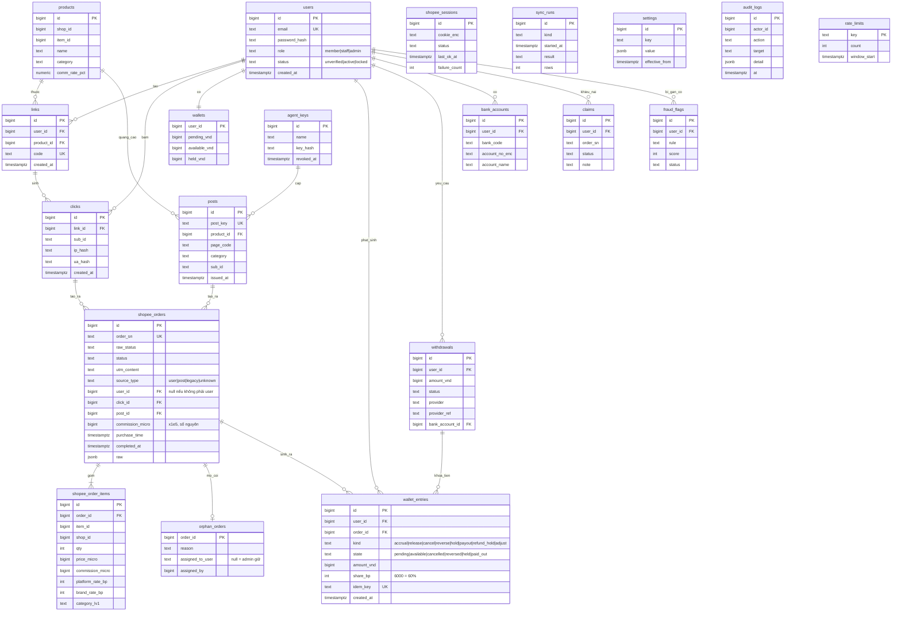

# 07 — Dữ liệu và quy ước `sub_id` v1

## 1. Quy ước `sub_id` (thay quy ước cũ "slot1 = bài, slot2 = số thứ tự")

`utm_content` có đúng 5 slot ngăn bằng `-`. Mỗi slot chỉ gồm `[0-9a-z]` (base36 chữ thường; không dùng chữ hoa vì chưa biết Shopee có hạ chữ thường không). **Không slot nào chứa `-`.** Slot rỗng được phép.

```
utm_content = s1 - s2 - s3 - s4 - s5
```

| Slot | Nội dung | Độ dài | Ví dụ |
|---|---|---|---|
| s1 | `{version}{type}`: version = 1 ký tự base36 (`1`); type: `u` = click của user web, `l` = link trực tiếp của user (dự phòng, không có click_id), `p` = bài Muse AI, `x` = thủ công/khác | đúng 2 | `1u` |
| s2 | id chủ sở hữu: `user_id` (u, l) hoặc `post_id` (p), base36 | 1–8 | `3f` |
| s3 | `click_id` (u), `link_id` (l), hoặc mã fanpage `page_code` (p), base36 | 1–8 | `k9z2` |
| s4 | chữ ký: 3 ký tự đầu của HMAC-SHA256(`SUBID_SECRET`, `s1-s2-s3`) đổi base36 | đúng 3 | `a7q` |
| s5 | dự trữ cho phiên bản sau (rỗng ở v1) | 0 | |

Ví dụ: user 123 (`3f`), click 98765 (`23zt` → minh họa) → `1u-3f-23zt-a7q-` → URL kết thúc `utm_content=1u-3f-23zt-a7q-`.

Tính chất:
- Truy ngược: `s1`→nguồn; `s2`→`users.id` hoặc `posts.id`; `s3`→`clicks.id`/`links.id`/`pages.code`.
- Phiên bản: ký tự đầu của s1. Bản cũ `fb01----` (không khớp mẫu v1) được giải mã thành `legacy` và đẩy vào đơn mồ côi/thống kê riêng, không làm hỏng dữ liệu.
- Chữ ký chống làm giả: người ngoài không tự sửa `s2` để cướp hoa hồng của người khác. Chữ ký sai → đơn mồ côi.
- Không chứa dữ liệu cá nhân: chỉ id nội bộ. Dùng base36 ngắn, không dùng UUID.
- Độ dài tối đa tổng ≈ 2+8+8+3 = 21 ký tự + 4 dấu phân cách = 25. **Kết quả test với Shopee (2026-11-27, PO cho phép):** link universal-link có `utm_content` dài 15, 25 và 89 ký tự đều trả 301, **giữ nguyên `utm_content`** và có `uls_trackid`. Ta vẫn giữ giới hạn tự đặt thấp (tổng ≤ 32). **Còn thiếu một bước kiểm tay:** báo cáo click/đơn của Shopee có hiển thị đủ sub_id không (xem mục 5). Test tự động chỉ chứng minh codec không vượt giới hạn tự đặt.
- Click level vs link level: `/go/` sinh `s3 = click_id` mỗi lần bấm (chính xác nhất). Khi `/go/` không dùng được thì web đưa `direct_url` dùng `type=l` (chỉ biết user + link, không biết click nào).
- Với Muse AI: `type=p`, `s2 = post_id` (do ta cấp theo `post_key` mà Muse gửi), `s3 = page_code`. Một bài = một `post_id` = một link; ngành/giờ/kiểu bài lưu ở bảng `posts`, không nhét vào `sub_id`.
- Đơn không giải mã được hoặc sai chữ ký hoặc id không tồn tại → `orphan_orders`.

Bắt buộc có test (Sprint 0): charset, không có `-` trong slot, độ dài từng slot và tổng, round-trip encode/decode, chữ ký sai bị từ chối, id lớn nhất (36^8−1) vẫn nằm trong giới hạn, id lớn hơn bị từ chối, parse `utm_content` kiểu `----` và kiểu cũ, `make_link` không đổi hành vi.

## 2. ERD


## 3. Mô tả bảng

| Bảng | Mục đích / lưu ý |
|---|---|
| `users` | Tài khoản. Email duy nhất (chuẩn hóa chữ thường). Không lưu SĐT/tên thật. |
| `products` | Chuẩn hóa `shop_id,item_id` (unique cặp). Tái dùng giữa nhiều link. |
| `links` | Mỗi lần user dán link → 1 dòng; `code` ngẫu nhiên cho `/go/<code>`. **Không dùng `sub_id` làm khóa**, không ghi đè được đích (khắc phục S3). |
| `clicks` | Mỗi lần bấm `/go/`. `ip_hash` dùng HMAC với `IP_SALT` bí mật, giữ 90 ngày. |
| `posts` | Mỗi bài Muse AI = 1 `post_key` (Muse đặt, duy nhất) → `post_id`. Giữ `category`, `page_code`. |
| `shopee_orders` / `_items` | Bản sao đơn từ Shopee, idempotent theo `order_sn`. Tiền là **bigint ×1e5**, không float. `raw` lưu JSON gốc để đối chiếu. |
| `orphan_orders` | Đơn không gán được người. Mặc định thuộc admin. |
| `wallets` | Số dư tổng hợp, chỉ cập nhật cùng transaction với `wallet_entries`. |
| `wallet_entries` | **Sổ cái chỉ thêm**: không UPDATE `amount`. Đổi trạng thái = thêm dòng mới. `idem_key` = `order_sn:item:kind` chống ghi trùng. |
| `withdrawals` | Yêu cầu rút. `provider`/`provider_ref` cho cổng. |
| `bank_accounts` | Số tài khoản mã hóa ở tầng ứng dụng (`APP_ENC_KEY`). |
| `shopee_sessions` | Cookie mã hóa, trạng thái sức khỏe. Chỉ admin cập nhật; không có API đọc lại giá trị. |
| `settings` | Cấu hình có `effective_from` (tỷ lệ 6000bp, ngưỡng rút, `hold_days`). Đơn lưu snapshot `share_bp` ở `wallet_entries`. |
| `sync_runs` | Lịch sử đồng bộ, dùng để biết "đã đồng bộ tới đâu" trước khi chuyển tiền. |
| `fraud_flags`, `claims`, `audit_logs`, `rate_limits`, `agent_keys` | Theo tên. `audit_logs` ghi mọi thao tác admin/staff. |

## 4. Quy tắc tiền
- Từ Shopee: số nguyên ×1e5 ("micro"). Từ micro sang đồng chỉ khi tính phần user, và **luôn làm tròn xuống**: `user_vnd = floor(commission_micro × share_bp / 10000 / 100000)`. Phần dư thuộc admin.
- Hoa hồng dùng `capped_commission` khi trường này **có mặt**, không dùng toán tử `or` (khắc phục lỗi hiện có).
- Chỉ đơn có trạng thái đủ điều kiện mới sinh `pending`; đơn chưa `COMPLETED` chỉ ghi nhận ước tính, không cộng ví.
- Mọi thay đổi số dư nằm trong 1 transaction, khóa dòng `wallets`.

## 5. Việc PO cần kiểm tay (chưa tự động được)
Ngày 2026-11-27 tôi đã gọi 3 link thử bằng `verify_link.py` với `utm_content` = `1x-3f-23zt-a7q-`, `1x-zzzzzzzz-zzzzzzzz-zzz-` và một chuỗi 89 ký tự bắt đầu `1x-aaaa…`. Vài giờ sau, mở dashboard Affiliate → Báo cáo → Click, tìm các dòng `1x-…` và kiểm tra cột sub_id có đầy đủ không (đặc biệt chuỗi 89 ký tự có bị cắt không). Nếu bị cắt hoặc không hiện, nhắn tôi độ dài hiển thị được; ta sẽ giảm giới hạn tự đặt cho phù hợp. Click tới từ IP của máy tôi nên chỉ là click thử, không phải đơn.
