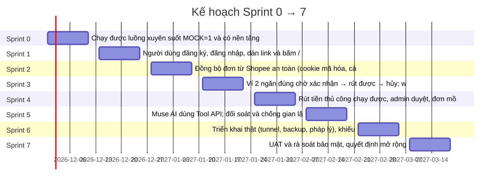

# 13 — Kế hoạch sprint

Giả định: sprint 2 tuần, velocity khởi đầu **30 điểm/sprint** (Codex và Claude làm song song; 1 điểm ≈ 30–60 phút việc đã rõ; người thật chủ yếu review/quyết định, ~10–15 giờ/tuần). Đây là **giả định chưa kiểm chứng**: nếu thực tế chỉ đạt 15 điểm/sprint thì tổng backlog (217 điểm) cần ~14 sprint (~7 tháng) thay vì 8. Sprint nào vượt velocity thì cắt Should/Could trước. Hiệu chỉnh sau Sprint 1.

## Sprint 0 (2026-11-30 → 2026-12-11) — 25 điểm, trong đó Must 25
**Sprint Goal:** Chạy được luồng xuyên suốt MOCK=1 và có nền tảng (repo, compose, DB, codec sub_id)

| Task | Tên | Điểm | Ưu tiên | Owner |
|---|---|---|---|---|
| T-001 | Là dev, tôi muốn monorepo có lint/format/.gitignore/AGENTS.md để hai agent làm cùng luật | 3 | Must | claude |
| T-002 | Là dev, tôi muốn docker compose up chạy đủ dịch vụ để phát triển cục bộ | 5 | Must | codex |
| T-003 | Là dev, tôi muốn CI GitHub Actions chạy lint và test để không merge code hỏng | 2 | Must | codex |
| T-004 | Là hệ thống, tôi muốn codec sub_id v1 có chữ ký để truy ngược đơn về đúng nguồn | 5 | Must | claude |
| T-005 | Là dev, tôi muốn migration Postgres đúng ERD cùng dữ liệu seed | 5 | Must | claude |
| T-006 | Là PO, tôi muốn test hồi quy make_link để refactor không làm hỏng link đã verify | 2 | Must | claude |
| T-007 | Là dev, tôi muốn client Shopee giả (MOCK=1) và fixture từ HAR để test không gọi live | 3 | Must | codex |

## Sprint 1 (2026-12-14 → 2026-12-25) — 31 điểm, trong đó Must 31
**Sprint Goal:** Người dùng đăng ký, đăng nhập, dán link và bấm /go/ ghi click

| Task | Tên | Điểm | Ưu tiên | Owner |
|---|---|---|---|---|
| T-010 | Là khách, tôi muốn đăng ký và đăng nhập bằng email để dùng dịch vụ | 5 | Must | codex |
| T-011 | Là thành viên, tôi muốn xác minh email và quên mật khẩu để lấy lại tài khoản | 5 | Must | codex |
| T-012 | Là admin, tôi muốn phân quyền member/staff/admin để tách trách nhiệm | 3 | Must | claude |
| T-013 | Là hệ thống, tôi muốn rate limit, chặn IP và audit log để chống lạm dụng | 5 | Must | claude |
| T-014 | Là thành viên, tôi muốn dán link Shopee để nhận link của mình | 5 | Must | codex |
| T-015 | Là thành viên, tôi muốn bấm /go/ (chạy trên Cloudflare Worker) để được chuyển sang Shopee và hệ thống ghi click | 8 | Must | claude |

> ⚠ 31 điểm vượt velocity giả định 30. Cần PO chọn: giãn sprint, tăng giờ làm, hoặc cắt Should/Could.

## Sprint 2 (2026-12-28 → 2027-01-08) — 31 điểm, trong đó Must 31
**Sprint Goal:** Đồng bộ đơn từ Shopee an toàn (cookie mã hóa, cảnh báo, đơn mồ côi)

| Task | Tên | Điểm | Ưu tiên | Owner |
|---|---|---|---|---|
| T-063 | Là admin, tôi muốn dán cookie Shopee được mã hóa at-rest và không đọc lại được | 5 | Must | claude |
| T-020 | Là sync-worker, tôi muốn client Shopee báo lỗi có kiểu, phân trang đủ, tiền số nguyên | 8 | Must | claude |
| T-021 | Là hệ thống, tôi muốn đồng bộ đơn định kỳ, quét lại 60 ngày, chạy bù khi bật lại | 8 | Must | claude |
| T-022 | Là hệ thống, tôi muốn khớp sub_id với click/user/post và đưa đơn lạ vào hàng mồ côi | 5 | Must | claude |
| T-023 | Là admin, tôi muốn cảnh báo khi cookie chết hoặc sync lỗi | 5 | Must | codex |

> ⚠ 31 điểm vượt velocity giả định 30. Cần PO chọn: giãn sprint, tăng giờ làm, hoặc cắt Should/Could.

## Sprint 3 (2027-01-11 → 2027-01-22) — 32 điểm, trong đó Must 32
**Sprint Goal:** Ví 2 ngăn đúng: chờ xác nhận → rút được → hủy; web hiển thị

| Task | Tên | Điểm | Ưu tiên | Owner |
|---|---|---|---|---|
| T-030 | Là hệ thống, tôi muốn sổ cái ví chỉ thêm, số nguyên, idempotent | 8 | Must | claude |
| T-031 | Là thành viên, tôi muốn tiền hoàn vào chờ xác nhận rồi mới thành rút được sau hạn trả hàng | 8 | Must | claude |
| T-032 | Là admin, tôi muốn cấu hình tỷ lệ 60/40, hold_days, snapshot theo đơn | 3 | Must | claude |
| T-033 | Là thành viên, tôi muốn giao diện đăng ký/đăng nhập, dán link, xem lịch sử | 8 | Must | codex |
| T-034 | Là thành viên, tôi muốn xem ví (chờ/rút được) và đơn của tôi | 5 | Must | codex |

> ⚠ 32 điểm vượt velocity giả định 30. Cần PO chọn: giãn sprint, tăng giờ làm, hoặc cắt Should/Could.

## Sprint 4 (2027-01-25 → 2027-02-05) — 24 điểm, trong đó Must 24
**Sprint Goal:** Rút tiền thủ công chạy được, admin duyệt, đơn mồ côi gán tay

| Task | Tên | Điểm | Ưu tiên | Owner |
|---|---|---|---|---|
| T-040 | Là thành viên, tôi muốn gửi yêu cầu rút tiền khi đủ ngưỡng | 5 | Must | claude |
| T-041 | Là admin, tôi muốn duyệt và chi trả thủ công bằng VietQR/CSV | 8 | Must | claude |
| T-043 | Là admin, tôi muốn dashboard tổng quan, quản lý user và đơn | 8 | Must | codex |
| T-044 | Là staff, tôi muốn gán tay đơn mồ côi cho user khi có khiếu nại | 3 | Must | codex |

## Sprint 5 (2027-02-08 → 2027-02-19) — 29 điểm, trong đó Must 8
**Sprint Goal:** Muse AI dùng Tool API; đối soát và chống gian lận cơ bản

| Task | Tên | Điểm | Ưu tiên | Owner |
|---|---|---|---|---|
| T-050 | Là Muse AI, tôi muốn tool API có key để tìm SP và lấy link theo từng bài | 8 | Must | claude |
| T-051 | Là Muse AI, tôi muốn insights doanh thu theo bài/ngành/giờ để học | 5 | Should | codex |
| T-052 | Là admin, tôi muốn đối soát: hoa hồng Shopee − chia user − lợi nhuận | 5 | Should | claude |
| T-053 | Là staff, tôi muốn phát hiện tự mua, cùng IP/thiết bị, hủy bất thường | 8 | Should | codex |
| T-054 | Là admin, tôi muốn tỷ lệ hoàn theo ngành/hạng | 3 | Could | codex |

## Sprint 6 (2027-02-22 → 2027-03-05) — 24 điểm, trong đó Must 14
**Sprint Goal:** Triển khai thật (tunnel, backup, pháp lý), khiếu nại

| Task | Tên | Điểm | Ưu tiên | Owner |
|---|---|---|---|---|
| T-024 | Là staff, tôi muốn import CSV báo cáo thủ công khi cookie chết | 5 | Should | codex |
| T-060 | Là admin, tôi muốn backup tự động mỗi ngày và test khôi phục | 3 | Must | codex |
| T-061 | Là PO, tôi muốn chạy web (Next.js) và backend ở máy nhà qua chung một Cloudflare Tunnel (chặn bởi T-016, T-017) | 5 | Must | claude |
| T-062 | Là thành viên, tôi muốn khiếu nại mua rồi chưa thấy đơn, tra theo click | 5 | Should | codex |
| T-064 | Là PO, tôi muốn Điều khoản và Chính sách quyền riêng tư (bản nháp để luật sư xem) | 3 | Must | claude |
| T-065 | Là admin, tôi muốn log có cấu trúc, che bí mật và trang health | 3 | Must | codex |

## Sprint 7 (2027-03-08 → 2027-03-19) — 21 điểm, trong đó Must 13
**Sprint Goal:** UAT và rà soát bảo mật, quyết định mở rộng

| Task | Tên | Điểm | Ưu tiên | Owner |
|---|---|---|---|---|
| T-042 | Là PO, tôi muốn spike và adapter cổng chi trả tự động (sau MVP, MVP dùng chuyển khoản thủ công) | 8 | Could | claude |
| T-070 | Là PO, tôi muốn thử nghiệm với vài user thật và 1 đơn thật (UAT) | 8 | Must | claude |
| T-071 | Là PO, tôi muốn rà soát bảo mật trước khi mở rộng | 5 | Must | claude |

## Gantt

## Mốc
- Hết Sprint 0: demo luồng MOCK=1.
- Hết Sprint 2: có dữ liệu đơn thật vào DB (sau khi PO cho phép gọi live).
- Hết Sprint 4: có thể rút tiền thủ công.
- **Cổng trước khi mở cho user ngoài:** R-02 (Shopee), R-06/R-17 (pháp lý), R-10 (auth), Sprint 7 (UAT + rà soát).
