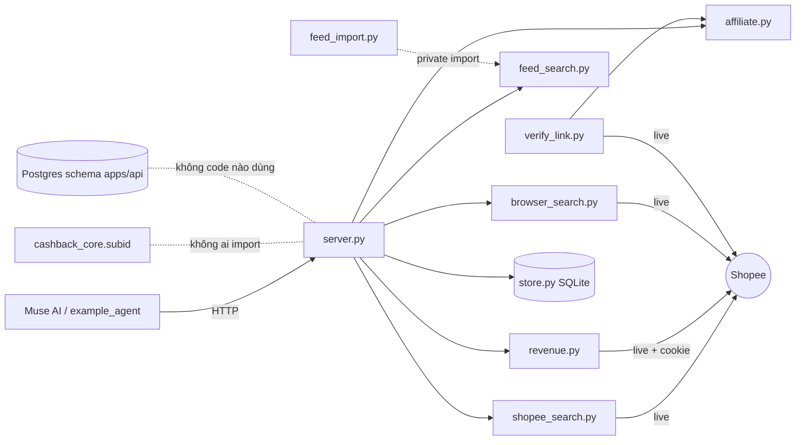

# 01 — Audit hiện trạng (Giai đoạn 1, chưa sửa code)

Ngày: 2026-11-27 · Commit gốc: `4fb184e` · Chạy với `MOCK=1`, không gọi live.
Ghi chú: `/ponytail-audit` và `/ponytail-debt` không có trong phiên này; audit làm bằng đọc tay toàn bộ file Python + chạy test + đo thử.

## 0. Phát hiện quan trọng nhất

Prompt mô tả "code chạy được nhưng rối". Thực tế repo **nhỏ (2.261 dòng Python, 51 file)** và chia hai nửa chưa nối với nhau:

1. **Service cũ** (SQLite, 10 module phẳng ở thư mục gốc): chạy được, test xanh, nhưng lẫn route/nghiệp vụ/cấu hình.
2. **Nền mới** (`packages/core`, `apps/api`): chỉ có codec `sub_id` v1 + schema Postgres + seed. **Chưa có** module `auth/links/clicks/orders/wallet/payouts`, chưa có `apps/web`, chưa có sync-worker. Không code nào đang import `cashback_core`.

Hệ quả: phần lớn cây thư mục đích ở Giai đoạn 2 là **dựng mới**, không phải "sắp xếp lại". Refactor thật sự chỉ áp dụng cho ~1.600 dòng service cũ. Rủi ro lớn nhất không phải code rối mà là **hai hệ thống song song** (SQLite/`sub_id` kiểu cũ vs Postgres/`sub_id` v1) sẽ lệch nhau nếu không chốt hướng chuyển.

## 1. Bản đồ hiện tại

```
.
├── server.py            266  HTTP (http.server) + nạp .env + điều phối search + dựng sub_id + gọi store
├── affiliate.py         143  sinh link affiliate (ĐÃ VERIFY, không đổi hành vi)
├── shopee_search.py     135  search qua API nội bộ Shopee (+ MOCK_ITEMS nhúng trong code)
├── feed_search.py       163  search trong CSV/JSON feed
├── feed_import.py       237  CLI chuẩn hóa feed (import private hàm của feed_search)
├── browser_search.py     77  search bằng Playwright
├── revenue.py           282  đọc dashboard affiliate (cookie) -> clicks/đơn/hoa hồng
├── store.py              93  SQLite: links + clicks
├── verify_link.py       100  CLI kiểm tra link (urllib, gọi live)
├── login_save_state.py   27  CLI lưu state Playwright
├── example_agent.py      73  ví dụ AI gọi tool
├── test_offline.py      118  16 check E2E in-process
├── test_make_link_regression.py 44  3 test khóa make_link
├── tools/{openai,gemini}_tools.json   schema tool cho AI
├── packages/core/cashback_core/subid.py   97  codec sub_id v1 (10 test)
└── apps/api/            Alembic 0001 (20 bảng) + seed + test_schema (cần Postgres)
infra/docker-compose.yml  db, migrate, seed
```



## 2. Danh sách vấn đề

Mức: **C** cao · **TB** trung bình · **T** thấp. "Đã xác nhận" = tái hiện được bằng `MOCK=1`.

### Lỗi thật (đã xác nhận)

| # | Vị trí | Triệu chứng | Vì sao khó | Mức |
|---|---|---|---|---|
| 1 | `server.py:225`, `store.py:48-53` | `POST /api/link` không truyền `sub` → mọi link dùng `sub="api"`; `ON CONFLICT(sub_id) DO UPDATE` ghi đè đích. Đã thử: tạo 2 link, `/go/api` trỏ về link **thứ hai**. Click của link trước bị tính sai/ mất đích | Mất tiền/click âm thầm, không có lỗi nào báo | **C** |
| 2 | `server.py:141,178,185` | `limit=abc` hoặc `days=abc` → `ValueError` không bắt → **kết nối bị cắt, không có HTTP response** (đã xác nhận) | AI gọi sai tham số là server trả rỗng, khó debug | **C** |
| 3 | `server.py:184-190,94` | `/api/revenue` và `/api/stats` **không có xác thực**, CORS `*`. Nếu đặt `PUBLIC_BASE`/`HOST=0.0.0.0` lên VPS thì ai cũng đọc được doanh thu thật | Lộ số liệu kinh doanh; ai gọi cũng khiến server bắn request tới Shopee bằng cookie của bạn (dễ làm cookie/IP bị chặn) | **C** |
| 4 | `server.py:151,161` | `sub_id` dựng từ **keyword người dùng** (`keyword[:12]-i`), không dùng `cashback_core.subid`, không chữ ký. Vi phạm quy ước v1 ("không đưa dữ liệu cá nhân", dùng codec) | Đơn về từ link này sẽ thành `legacy`/mồ côi; trộn dấu `_`/`-` rồi `normalize_sub_id` đổi `_`→`-` làm sub_id trong DB ≠ sub_id trên link | **C** |
| 5 | `server.py:82` | `IP_SALT` mặc định cứng `"zaka"`; hash 16 hex của IPv4 dò ngược được vì không gian nhỏ | Quyền riêng tư click yếu nếu quên đặt env | TB |

### Cấu trúc / trùng lặp

| # | Vị trí | Triệu chứng | Mức |
|---|---|---|---|
| 6 | `server.py:123-216` (`do_GET` 94 dòng) | Routing + điều phối search + dựng sub_id + sinh link + ghi DB trong một hàm. `server.py:52-75` (`do_search`) là nghiệp vụ nằm trong file HTTP | **C** |
| 7 | `affiliate.py:57-71` vs `cashback_core/subid.py` | **Hai hệ sub_id**: `normalize_sub_id` (chuỗi tự do, tự đệm `-`, cờ `SUB_ID_PAD`) và codec v1. Không chỗ nào kiểm tra sub_id đưa vào `make_link` có hợp lệ v1 | **C** |
| 8 | `revenue.py:37,145-149`, `shopee_search.py:65`, `feed_search.py:62-78,97`, `feed_import.py:54-86` | Quy đổi tiền ×1e5 viết ở 3 nơi bằng **float**; heuristic `price > 10_000_000 → /1e5` sai với hàng ≥ 10 triệu đồng; `comm_rate < 1 → ×100` không phân biệt 0,5% với 50%. Vi phạm luật "tiền là số nguyên" | **C** |
| 9 | `feed_search.py:62` vs `feed_import.py:67` | Hai bản `_num`/`to_float` gần giống; `feed_import` import hàm private `_norm_key`, `_pick`, `COLS` của `feed_search` | TB |
| 10 | `shopee_search.py`, `revenue.py`, `browser_search.py`, `verify_link.py`, `login_save_state.py` | **5 nơi gọi Shopee**, 2 thư viện HTTP (`requests`, `urllib`), 3 User-Agent khác nhau (Chrome 124 ×2, 157), 2 tên biến cookie (`SHOPEE_COOKIE`/`AFF_COOKIE`). Luật "chỉ một client gọi Shopee" chưa có | TB |
| 11 | toàn repo | **47 dòng đọc `os.environ`** rải ở 11 file; vài chỗ đọc lúc import (`store.py:7`, `shopee_search.py:14`, `server.py:77`) nên test phải set env trước import; `load_env()` chạy trước các import (`server.py:40`) | TB |
| 12 | `store.py` vs `apps/api/migrations/0001` | Hai lược đồ lệch nhau (`links.sub_id` PK + `target` vs `links(user_id, product_id, code)`). Chưa có kế hoạch chuyển dữ liệu/ API | **C** (kiến trúc) |
| 13 | `shopee_search.py:21-32` | `MOCK_ITEMS` nằm trong code sản xuất, không ở fixture. MOCK rẽ nhánh trong hàm thật (`:84`) | T |
| 14 | `tools/*.json`, `example_agent.py`, `server.py` docstring | Hợp đồng tool AI viết 4 lần, tay | T |

### Lỗi bị nuốt / log

| # | Vị trí | Triệu chứng | Mức |
|---|---|---|---|
| 15 | `server.py:112` | JSON hỏng → trả `{}` → client nhận "cần url hoặc item_id" (sai nguyên nhân) | TB |
| 16 | `shopee_search.py:131`, `browser_search.py:67,73`, `feed_search.py:77` | `except Exception` bắt cả lỗi lập trình; không log traceback, chỉ gói thành chuỗi `error` | TB |
| 17 | `server.py:115-117` | Không có log request/lỗi/thời gian. Không `logging`, không `request_id` (chỉ `print` khi khởi động) | TB |
| 18 | `server.py:134` | `/health` lộ đường dẫn `FEED_FILE` | T |

### Độ dài

Hàm > 50 dòng: `do_GET` 94, `convert` (feed_import) 90, `summary` (revenue) 74, `browser_search.search` 62, `shopee_search.search` 56, `test_offline.main` 80. File > 300 dòng: **không có** (lớn nhất 282).

### Test

| # | Thiếu | Mức |
|---|---|---|
| 19 | Chưa có test cho: `revenue.py` (parse số, `_paged`, gom theo sub_id), `feed_search` (tính điểm, `_num`), `feed_import`, `store.stats`, `shopee_search._normalize`. Chưa có bug nào trong #1–#4 bị test bắt | **C** |
| 20 | `test_offline.py:86-92` **ghi đè `samples/sample_feed.csv` đang được git theo dõi**, dùng cổng cố định 8931, đặt env toàn cục; không phải `unittest` nên không chạy được bằng discover | TB |
| 21 | `apps/api/tests/test_schema.py` cần Postgres + `sqlalchemy`; hard-code số user seed (`{"admin":1,"member":2}`) nên vỡ nếu DB có dữ liệu khác | T |
| 22 | Ví, đối soát, sync: **chưa có code** nên cũng chưa có test (chỉ có ràng buộc DB) | — |

### Hiệu năng (nghi vấn / đã đọc code, chưa đo tải)

| # | Vị trí | Triệu chứng | Mức |
|---|---|---|---|
| 23 | `server.py:164`, `store.py:45` | `/api/search` ghi `save_link` **từng item một**, mỗi lần mở kết nối + commit mới (tới 60 commit/request) | TB |
| 24 | `store.py:33-41` | `clicks(sub_id)` **không có index**; `stats()` LEFT JOIN toàn bảng → chậm dần theo số click | TB |
| 25 | `revenue.py:152-225` | `/api/revenue` = 1 + N + M request Shopee **tuần tự** (mỗi trang 100 dòng, tối đa 40 trang), không cache, chặn một thread server; `window()` gọi 5 lần nên mốc thời gian có thể lệch qua nửa đêm | TB |
| 26 | `shopee_search.py:101-133` | Retry 3 lần kèm `sleep` 2–6 giây **trong thread xử lý request** | TB |
| 27 | `feed_search.py:143-152` | Mỗi search chạy `SequenceMatcher` trên **mọi dòng** feed (O(n·độ dài tên)). Với feed hàng chục nghìn dòng sẽ chậm; chưa đo vì feed mẫu chỉ 3 dòng | T |
| 28 | `0001_init.py` | Thiếu index cho FK/lọc: `clicks(sub_id)`, `shopee_orders(click_id)`, `(post_id)`, `(status)`, `wallet_entries(order_id)`, `(withdrawal_id)`, `clicks(created_at)` | TB |

### Ranh giới an toàn tiền (cho thiết kế sau)

- `wallets` có thể bị `UPDATE` trực tiếp bởi bất kỳ code nào; DB chỉ có `CHECK >= 0`. Luật "chỉ `wallet` đổi số dư" mới nằm ở tài liệu, chưa có ràng buộc (DB role/trigger hoặc lint test). **TB**
- Không có vòng import. Phụ thuộc chéo duy nhất đáng kể: `feed_import → feed_search` (private).

## 3. Baseline

Máy: macOS, Python 3.13.12. Không cài `coverage`; Docker `infra-db-1` đang chạy.

| Chỉ số | Giá trị |
|---|---|
| `test_offline.py` | 16 check, pass, 1,17 s (0,4 s là `sleep` khởi động) |
| `test_make_link_regression.py` | 3 test, pass, 0,05 s |
| `packages/core` | 10 test, pass, 0,03 s |
| `apps/api` test_schema | **chưa đo**: `sqlalchemy` không có trong Python hệ thống (cần chạy trong container/venv) |
| Tổng test đã chạy | **29 pass, 0 fail** |
| Coverage | **chưa đo** (chưa cài tool; sẽ dùng `coverage` trong venv ở bước 1) |
| Python | 2.261 dòng / 20 file; 10 module phẳng ở gốc |

Thời gian phản hồi (in-process, `MOCK=1`, SQLite tạm, 50 lần/endpoint, trên loopback):

| Endpoint | p50 | p95 |
|---|---|---|
| `GET /health` | 1,7 ms | 4,2 ms |
| `GET /api/search?limit=5` | 2,5 ms | 3,2 ms |
| `POST /api/link` | 1,0 ms | 1,6 ms |
| `GET /go/<sub>` (302) | 1,4 ms | 2,3 ms |
| `GET /api/stats` | 1,1 ms | 1,7 ms |

Không đo được (cần live hoặc chưa tồn tại): `/api/revenue`, engine `api`/`browser`, **job sync** (chưa có sync-worker; `revenue.summary` là thứ gần nhất và cần cookie thật). Baseline hiệu năng thật sự nằm ở các đường này, nên Giai đoạn 3 cần fixture HAR đã ẩn danh (T-007) trước khi nói được chuyện tối ưu.

## 4. Đề xuất ngắn cho Giai đoạn 2 (để duyệt ở Checkpoint 1)

- Tách thành hai việc: **(a)** dọn service cũ vào cấu trúc mới; **(b)** dựng module mới (auth, wallet…) theo `_template`. Refactor nên chỉ làm (a), còn (b) đi theo backlog.
- Sửa #1–#4 **sau khi có test tái hiện**, tách commit `fix(...)` riêng khỏi commit `refactor(...)` (luật "hành vi giữ nguyên" bị phá nếu gộp).
- Cần chốt trước: bỏ SQLite và chuyển `links/clicks` sang Postgres ngay, hay giữ SQLite cho đến khi có `modules/links`?
